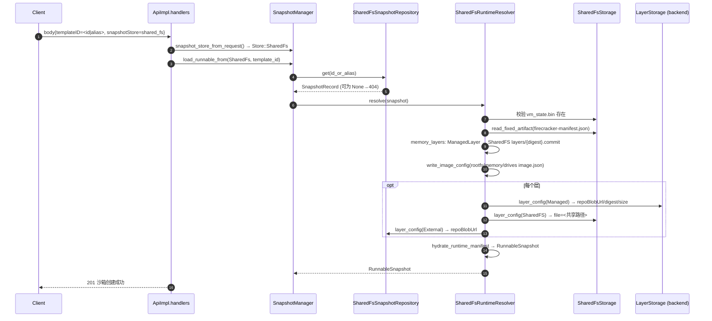

# AgentENV 快照落到跨节点共享文件系统 —— 需求描述与方案设计

> 状态：已实现（与代码同步）
> 范围：在现有 snapshot backend（OSS / posix_fs）之上增加一个可选、请求级可控的"共享文件系统层存储"store，不改变默认路径行为。
> 架构：backend 无关的装饰器（decorator）+ `LayerStorage` trait，backend 只实现层存取接口，不感知共享文件系统。

---

## 1. 背景与目标

AgentENV 在 OSS/posix_fs backend 下提交快照：增量层、vm_state、catalog 全部走 backend 应有的持久化路径。
需求方有**跨节点共享文件系统**（各节点同一绝对挂载点），希望：

- 快照**增量 layer**（capture 产生的 delta 层）直接落共享文件系统，避免上传对象存储的开销；
- 共享文件系统上也放一份 **catalog（record/alias）**，使其他节点带参数拉起沙箱时能直接从共享文件系统找到该快照的 meta 与数据；
- **base layer 完全不变**——原来从哪里获取就从哪里获取（registry 的走 `External`，本地物化走 backend 自己的 managed-layer 存储 `Managed`）；
- 通过 **API 请求级参数** `snapshotStore` 区分该分支，不带参数的请求行为与现在**完全一致**；
- 代码上**不引入 if-backend 分支**：共享文件系统逻辑收敛在独立模块，backend 只实现一个 `LayerStorage` trait。

### 1.1 术语

| 术语 | 含义 | 代码位置 |
| --- | --- | --- |
| record | 一份快照的元数据档案（`SnapshotRecord`），含层级引用 `committed` | `src/snapshot/types/snapshot.rs` |
| catalog | record 与 alias 的存储与索引（`catalog/records/{id}.json`, `catalog/aliases/{alias}`） | posixfs `catalog.rs` / oss `layout.rs` / 共享 fs 复用 `PosixFsCatalogStore` |
| delta/增量 layer | capture 阶段生成的 sealed 层（`snapshot.commit`、`managed-base.commit`、`snapshot.zfile.commit`） | `src/image/local_layer.rs:20` |
| base layer | 镜像原有层（registry 引用或有 repoBlobUrl 的层 / backend 管理的内容寻址层） | `ExternalLayer` / `ManagedLayer` |
| store | 请求级的存储选择（`default` 或 `shared_fs`），对应 `SnapshotStore` | `src/snapshot/manager.rs` |

---

## 2. 需求描述

### 2.1 功能需求（FR）

- FR1：请求体可选字段 `snapshotStore`（`"default"` / `"shared_fs"`，缺省 `default`）。已支持的请求体：
  - `NewSandbox` / `NewSandboxV2`（拉起沙箱，解析模板）
  - `SandboxSnapshotRequest`（发布快照）
  - `SnapshotManager` 层面向所有 catalog 操作提供 `*_from(SnapshotStore, …)` 变体（get/list/delete/resolve_alias/try_start_build/mark_build_error），模板与快照目录端点的 HTTP 参数暴露后续可加。
- FR2：`snapshotStore=shared_fs` 的快照发布：`record`/alias 落**共享文件系统 catalog**；固定产物（`vm_state.bin`、`firecracker-manifest.json`、可选 `memory-startup.pack`）与**增量 layer** 落共享文件系统 `snapshots/{id}/` 下。
- FR3：该快照的 base layer 引用保持原样写进 record（`External`→原 registry / `Managed`→backend managed-layer），数据不动。
- FR4：`snapshotStore=shared_fs` 的拉起：从共享文件系统 catalog 读 record 与固定产物，增量层 `file=` 直指共享路径恢复，base 层按 record 引用从原来源恢复。
- FR5：开关与根路径由配置 `[snapshot.shared_fs] enabled + root` 指定（`root` 也可用 `AENV_SNAPSHOT_SHARED_FS_ROOT`），启动时校验绝对路径存在；同一挂载点约定写入文档（D1）。
- FR6：未启用时带 `snapshotStore=shared_fs` 的请求返回 400。

### 2.2 非功能需求（NFR）

- NFR1：不带参数/缺省请求：**运行时行为与现状完全一致**（同一代码路径、存储位置、性能、响应结构）。
- NFR2：`p2p`、`image_export`、`volume`、`template builder` 等横切流程不因该分支改动行为；仅需为新增层引用变体 `OverlaybdLayerRef::SharedFS` 补 `match` 臂以保证编译。
- NFR3：跨节点语义：其他节点同样启用共享 fs 配置后，带参数请求即可从共享 fs catalog 解析。
- NFR4：共享 fs 故障 → 带参数的快照不可用（无 OSS 兜底），文档明确该边界。
- NFR5：record 序列化向后兼容（新层引用变体不影响读取旧快照）。

---

## 3. 总体设计

### 3.1 关键决策

| 决策点 | 结论 |
| --- | --- |
| backend 感知 | **否**。共享文件系统逻辑在独立模块 `sharedfs/`，backend 只实现 `LayerStorage` trait（导入 base 层 + 提供 Managed 层 runtime 配置）。加新 backend 只需实现该 trait。 |
| 触发方式 | API 请求级参数 `snapshotStore`（可选，缺省走默认 backend 实例）。 |
| 配置形态 | `[snapshot.shared_fs] enabled + root`（布尔开关 + 嵌套配置），不使用"层存储来源"枚举；`root` 支持 `AENV_SNAPSHOT_SHARED_FS_ROOT`。 |
| catalog 归属 | 带参请求 → 共享文件系统（复用 `PosixFsCatalogStore`，root=共享挂载点）；不带参 → backend 原样。 |
| base layer | 完全不变（External→registry；本地层→backend managed-layer / Managed）。 |
| 共享 fs 数据免疫范围 | 固定产物 + 增量 layer + record/alias。 |
| 与 backend 的关系 | OSS / posix_fs 默认实例始终存在；共享 fs 实例是**额外的装饰器**（可选构建），二者 catalog 独立、互不干扰。 |
| 校验约束 | 目前仅允许 `repository_backend=oss` 时启用（`cfg` 启动校验）；`LayerStorage` 两个 backend 都已实现，posix_fs 组合为后续放开预留。 |

### 3.2 架构

```
                        ┌─────────────────────────────┐
                        │          ApiImpl           │
                        │  handler(拉起 / 发布快照)    │
                        └──────────────┬──────────────┘
                                       │ body.snapshotStore (可选)
                                       ▼
                        ┌─────────────────────────────┐
                        │        SnapshotManager      │
                        │  现有方法 = Default 实例       │
                        │  *_from(SnapshotStore, …)     │  ← 路由
                        └──────┬──────────────┬────────┘
                     default   │              │shared_fs (enabled 时)
                               ▼              ▼
                 ┌─────────────────────┐  ┌────────────────────────────────────┐
                 │  原 backend 实例      │  │  SharedFsSnapshotRepository (装饰器) │
                 │  SnapshotRepository  │  │  + SharedFsRuntimeResolver(装饰器)   │
                 │  + RuntimeResolver   │  └────────────────────┬───────────────┘
                 │  (OSS/posix, 现状)    │                       │ delegate base
                 └─────────────────────┘       ┌───────────────┴────────────────┐
                                ┌────────────┐ │  SharedFsStorage               │
                                │ LayerStorage│ │  · catalog (PosixFsCatalogStore)│
                                │ (backend   │ │  · snapshots/{id}/artifacts+layers│
                                │  实现)      │ └───────────────────────────────┘
                                └────────────┘
```

要点：

- `SnapshotRepository` / `SnapshotRuntimeResolver` **trait 不变**；装饰器实现同一组 trait，可整体替换。
- 装饰器把 **snapshot 相关的发布/解析**路由到共享 fs，把 **非 snapshot 语义的 API**（volume、build-cache）直接委托给内层 backend。
- `Storage` 目录：

```
{root}/                                  # [snapshot.shared_fs].root，各节点同一挂载点
├── catalog/
│   ├── records/{id}.json                # SnapshotRecord（含层引用）
│   └── aliases/{alias}
└── snapshots/{id}/
    ├── vm_state.bin
    ├── firecracker-manifest.json
    ├── memory-startup.pack              # 可选
    └── layers/
        ├── snapshot.commit              # rootfs 增量层（SharedFS，保留原文件名）
        └── {digest}.commit              # 内存层（digest 寻址，`:`/`/`→`_`）
```

- 请求级参数只在 handler → `SnapshotManager.*_from(store, …)` → `resolve_repository(store)` 出现。

---

## 4. 流程图

### 4.1 快照发布（capture→publish，`POST /sandboxes/{id}/snapshots`）

```mermaid
sequenceDiagram
    autonumber
    participant C as Client
    participant H as ApiImpl.handlers
    participant M as SnapshotManager
    participant O as Orchestrator
    participant R as SharedFsSnapshotRepository (装饰器)
    participant S as SharedFsStorage
    participant L as LayerStorage (backend)
    participant B as 原 backend

    C->>H: body{snapshotStore=shared_fs, name=alias}
    H->>M: snapshot_store_from_request() → Store::SharedFs (未启用则 400)
    H->>O: capture_snapshot(sandbox_id)
    O-->>H: CapturedSandboxSnapshot (本地文件)
    H->>M: publish_captured_from(SharedFs, meta, captured)
    M->>R: repository.publish(meta, manifest)
    R->>S: catalog().begin_publish(id)          # 发布会话
    R->>S: store_fixed_artifact(vm_state.bin)
    R->>S: store_fixed_artifact(firecracker-manifest.json)
    loop rootfs / memory / attached drives
        R->>R: derive_disk_layers(image.json)
        alt 层文件名 ∈ {snapshot.commit, managed-base.commit, snapshot.zfile.commit}
            R->>S: store_delta_layer(→ layers/<原名>)   # 增量层
            R->>R: OverlaybdLayerRef::SharedFS{path,digest,size,uuid}
        else 本地 base 层有 descriptor
            R->>L: import_disk_base_layer(src,digest,size)
            L-->>R: ManagedLayer (OSS upload / posix hard-link)
            R->>R: OverlaybdLayerRef::Managed
        else registry 引用
            R->>R: OverlaybdLayerRef::External (repoBlobUrl)
        end
        R->>S: (memory 层) copy → layers/{digest}.commit, 记 ManagedLayer
    end
    R->>S: catalog().commit_publish(record)
    R-->>M: SnapshotRecord
    M->>B: (可选) publish_p2p_artifacts (best-effort)
    H-->>C: 201 SnapshotInfo
    注: 任一失败 → S.cleanup_snapshot_dir(id) + 删除发布会话
```

失败语义：发布途中任何错误回滚共享 fs 目录（`cleanup_snapshot_dir`），catalog 不留半成品 record。

### 4.2 拉起沙箱（从快照恢复，`POST /sandboxes`）



注意：内存层以 digest 寻址落共享 fs `layers/{digest}.commit`，record 里记 `ManagedLayer`；解析时重新通胀为 `SharedFS` 引用（路径由当前节点挂载点推导）。

### 4.3 catalog 查询（模板/快照的 get/list/delete/alias 解析/构建状态）

实际把 `*_from` 接到 HTTP 的端点目前是"发布按 `snapshotStore` 选择 store"（FR1 提及两类请求体）；模板目录类端点暂以默认 store 服务。`SnapshotManager` 对每个操作都有 store 变体，共享 fs 实例的 catalog 操作落在共享 fs：

```mermaid
flowchart TD
    A[Manager.get/list/delete/resolve_alias/try_start_build/mark_build_error]
    A --> A1[Default 实例]
    A1 --> B[原 backend catalog<br/>OSS 或 posix]
    A --> A2[SharedFs 实例]
    A2 --> C[共享 fs catalog<br/>records + aliases]
    C --> D[delete 时同时清理 snapshots/{id}]
```

---

## 5. 文件与 catalog 的实际布局（对比）

以 snapshot id 取 `3f2c…b1`、含 1 个 base registry 层 + 1 个本地物化 base 层 + 1 个增量层为例。

### 5.1 现状（默认 backend，不变）

OSS backend：

```
OSS bucket/{prefix}/
├── catalog/records/3f2c….json
├── catalog/aliases/ubuntu-work
├── artifacts/3f2c…/vm_state.bin
├── artifacts/3f2c…/firecracker-manifest.json
├── managed-layers/sha256:<base-a>            ← base 本地物化层（Managed）
└── managed-layers/sha256:<delta-1>           ← 增量层（默认也进 backend）
# base registry 层：不进 OSS，走 External（repoBlobUrl→registry）
```

posix backend（根为 `[backend.posix_fs].snapshot_store/repository`）：

```
…/repository/
├── catalog/records/3f2c….json
├── catalog/aliases/ubuntu-work
├── artifacts/3f2c…/vm_state.bin
├── artifacts/3f2c…/firecracker-manifest.json
├── managed-layers/sha256:<base-a>            ← base 本地物化层（Managed）
└── managed-layers/sha256:<delta-1>           ← 增量层（默认也进 backend）
```

### 5.2 本方案（`snapshotStore=shared_fs` 分支）

```
# —— 共享文件系统（同一挂载点，各节点可见）——
/mnt/aenv-snapshots/
├── catalog/records/3f2c….json                ← record（meta，层引用自描述）
├── catalog/aliases/ubuntu-work
└── snapshots/3f2c…/
    ├── vm_state.bin
    ├── firecracker-manifest.json
    ├── memory-startup.pack                    ← 可选
    └── layers/
        ├── snapshot.commit                    ← rootfs 增量层（SharedFS·保留原名）
        └── mem_compacted.commit               ← 内存层（SharedFS·原名 / digest 名）

# —— 原 backend（仅 base 层，数据不动）——
OSS bucket/{prefix}/ (或 posix …/managed-layers)
└── managed-layers/sha256:<base-a>             ← 本地物化 base 层（Managed），照旧
# base registry 层：仍走 registry repoBlobUrl（External），不进 backend、不进共享 fs
```

### 5.3 record（`catalog/records/{id}.json`）实际内容示例（shared_fs 分支）

```jsonc
{
  "id": "3f2c…b1",
  "alias": "ubuntu-work",
  "source": { "sandbox": { "sourceSandboxId": "sb-…" } },
  "committed": {
    "runtimeVersions": { "kernelVersion": "…", "firecrackerVersion": "…" },
    "virtualizationMode": "kvm",
    "rootfsLayers": [
      { "external": { "digest": "sha256:<base-registry>", "repoBlobUrl": "https://registry/ns/img/blobs", "size": 12345 } },   // base 不变
      { "managed":  { "digest": "sha256:<base-a>", "size": 67890, "uuid": "…" } },                                            // 本地 base 照旧
      { "sharedFS": { "path": "/mnt/aenv-snapshots/snapshots/3f2c…/layers/snapshot.commit",
                      "digest": "sha256:<delta-1>", "size": 2345, "uuid": "…" } }                                            // ★ 增量层
    ],
    "memoryLayers": [
      { "digest": "sha256:<mem>", "size": 888, "uuid": null }                                                                  // digest 寻址
      // 字节位于 /mnt/aenv-snapshots/snapshots/3f2c…/layers/sha256_<mem>.commit
    ],
    "attachedDrives": [ /* 同构：delta→sharedFS, base→external/managed */ ]
  }
}
```

> 说明：不带参请求的 record 完全同构，只是无 `sharedFS` 臂（增量层也是 `managed`）。

### 5.4 运行时恢复出的 image.json（拉起时在节点缓存重建）

`{local_cache}/runtime/{id}/rootfs/image.json` 的 `lowers`：

```jsonc
[
  { "repoBlobUrl": "https://registry/ns/img/blobs", "digest": "sha256:<base-registry>", "size": 12345 },                        // External
  { "repoBlobUrl": "<oss-managed-url>",             "digest": "sha256:<base-a>",        "size": 67890 },                        // Managed→backend
  { "file": "/mnt/aenv-snapshots/snapshots/3f2c…/layers/snapshot.commit",
    "digest": "sha256:<delta-1>",                   "size": 2345 }                                                              // ★ SharedFS 本地直读
]
```

内存侧同理写 `<runtime>/memory/image.json`，附加盘写 `<runtime>/drives/{id}/image.json`。

---

## 6. 修改点清单（与实现一致）

| # | 文件 | 改动 | 默认路径影响 |
|---|---|---|---|
| 1 | `src/snapshot/types/snapshot.rs` | 新增 `SharedFSPathLayer{path,digest,size,uuid}` 与 `OverlaybdLayerRef::SharedFS` 变体；`types/mod.rs`、`snapshot/mod.rs` 导出 | 无（serde 兼容） |
| 2 | `src/cfg.rs` | 新增 `SnapshotSharedFsConfig{enabled,root}`（`root` 支持 `AENV_SNAPSHOT_SHARED_FS_ROOT`）；normalize：enabled 时要求绝对路径；validate：要求 `repository_backend=oss` 且 root 存在 | 默认 `enabled=false`，不触发新校验 |
| 3 | `config/default.toml` | `[snapshot.shared_fs]` 注释示例（enabled/root） | 无（默认注释） |
| 4 | `src/snapshot/repository/backends/sharedfs/mod.rs`（新） | `SharedFsStorage`（catalog + snapshots/{id}）、`LayerStorage` trait、`derive_disk_layers`/`derive_memory_layers`、`SharedFsSnapshotRepository`（装饰器）、`SharedFsRuntimeResolver`（装饰器） | 仅在 `enabled` 时实例化 |
| 5 | `src/snapshot/repository/backends/mod.rs` | `build_backend_parts` 返回三元组（+`LayerStorage`）；`build_shared_fs_backend` 按 `enabled` 构建装饰器对 | 默认实例构造不变 |
| 6 | `src/snapshot/repository/backends/oss/{mod,repository}.rs` | `OssSnapshotRepository` 实现 `LayerStorage`（`import_*_base_layer`→OSS managed-layers；`managed_base_layer_config`→repoBlobUrl） | 默认路径原样 |
| 7 | `src/snapshot/repository/backends/posixfs/{backend,artifacts}.rs` | `PosixFsBackend` 拆分 `LayerStorage`；`PosixFsArtifactStore` 实现 `LayerStorage`（hard-link 进 managed-layers） | 默认路径原样 |
| 8 | `src/snapshot/runtime_support.rs` | `materialize_image_config` 增 `SharedFS` arm → `LayerConfig{file}` | 无 |
| 9 | `src/snapshot/repository/backends/common/mod.rs` | `materialize_volume_image_config` 增 `SharedFS` arm | 无 |
| 10 | `src/snapshot/manager.rs` | `SnapshotStore{Default,SharedFs}`；持有可选 `shared_fs` 对；`publish/publish_captured/load_runnable/get/list/delete/resolve_committed_alias/try_start_build/mark_build_error` 的 `*_from` 变体；`shared_fs_enabled()` | 现有调用点零改动 |
| 11 | `src/api/openapi.yml` | `NewSandbox` / `NewSandboxV2` / `SandboxSnapshotRequest` 增可选 `snapshotStore`（enum: default/shared_fs，缺省 default） | 缺省=default |
| 12 | `src/api/impls/sandbox.rs` | `snapshot_store_from_request()`（校验/映射→400）；`sandboxes_post`→`load_runnable_from`；`v2_sandboxes_post` 转发字段；快照发布→`publish_captured_from` | 缺省路径不动 |
| 13 | `src/api/generated/src/models.rs` | 手工补丁 `snapshot_store` 字段 + `FromStr`（codegen 因 npm 网络受阻，未用 `make agentenv-server`） | 与生成器输出等价的补丁 |
| 14 | `src/snapshot/image_export/{service,target}.rs` | SharedFS 层按本地文件 `blob_put` 到目标 registry；`resolve_snapshot_image_target` 忽略 SharedFS 作为来源 | 默认不产 SharedFS |
| 15 | 全仓既有 `match OverlaybdLayerRef` | 补 `SharedFS` 臂（oss/repository、oss/resolver、posixfs/artifacts、manager、common 等） | 仅为编译；默认路径不产 SharedFS 引用 |

注意：#13 是**生成文件的手工补丁**。`cargo adev codegen server` 因 npx 依赖网络（npm registry 经代理不稳定）被阻塞；待网络可用时应运行 `make agentenv-server` 重新生成以替换手写补丁，并核对 diff 一致。

---

## 7. 兼容性与边界

- 未配置共享 fs（`enabled=false`）：不构建共享 fs 实例，所有请求走现状；带 `snapshotStore=shared_fs` → 400。
- 配置共享 fs：缺省请求仍走 backend 实例；仅带参请求走共享 fs。二者 catalog 独立，同名 alias 互不干扰。
- 共享 fs 故障时，shared-fs 快照不可用；backend 中 base 层不受影响，独立 GC 语义不变。
- 删除 shared-fs 快照：删共享 fs 的 record + `snapshots/{id}`；backend 内 base Managed 层按内容寻址由既有 GC 管理。
- ：`SharedFSPathLayer.path` 是**节点相关绝对路径**，违反"只提交逻辑引用"铁律 → 以 D1（挂载点一致 + 启动校验 root 存在 + 文档约束）作为有意例外，record 中随路径同时存 digest/size 供校验。

---

## 8. 验证方案

### 8.1 单元测试（`cargo test -p agentenv --lib`）

| # | 用例 | 关键断言 |
|---|---|---|
| 1 | `cfg` 配置项 | `enabled=false` 正常运行；`enabled=true` 时 `root` 为空 / 非绝对路径 / 目录不存在 / `repository_backend≠oss` 均启动报错；`AENV_SNAPSHOT_SHARED_FS_ROOT` 可覆盖 root |
| 2 | 发布写共享 fs | `publish_from(SharedFs,…)` 后 `{root}/catalog/records/{id}.json`、`alias`、`snapshots/{id}/{vm_state.bin, firecracker-manifest.json}`、`snapshots/{id}/layers/<delta>` 存在 |
| 3 | base 层路由 | 增量层 `file=` 在共享 fs；本地 base → backend managed-layer（OSS 上传 / posix hard-link）；registry base → `External` |
| 4 | 解析 image.json | `load_runnable_from(SharedFs)` 重建的 rootfs/memory/drives image.json 中 SharedFS `file=` 直指共享路径、Managed 保持 repoBlobUrl、External 原样 |
| 5 | 内存层恢复 | 发布内存层落到 `layers/{digest}.commit`；resolve 时重读并按 digest 名重建引用 |
| 6 | catalog 隔离 | 默认实例与共享 fs 实例各自 get/list/delete 互不串扰（同名 alias 两种 store 各自解析） |
| 7 | 删除语义 | `delete_from(SharedFs, id)` 清 record+alias+`snapshots/{id}`；backend base 层保留直至既有 GC |
| 8 | 失败回滚 | 中途失败后 `snapshots/{id}` 被清空，catalog 无半成品 |
| 9 | 未启用时 400 | 构建不含共享 fs 实例的 manager 时 `snapshot_store_from_request("shared_fs")` 返回 400 |

### 8.2 双进程 / 双节点冒烟

前置：两个节点都配置 `[snapshot.shared_fs] enabled = true, root = /mnt/aenv-snapshots`（同一挂载点），`repository_backend = oss`，共享 fs 目录两节点可见。

| # | 步骤 | 期望 |
|---|---|---|
| 1 | 节点 A：`POST /sandboxes/{sb}` with `snapshotStore=shared_fs` 用别名发布 | 201；共享 fs 出现 record/固定产物/增量层；OSS 仅新增 base managed-layer |
| 2 | 节点 B：`POST /sandboxes` with `templateID=<A 的别名>, snapshotStore=shared_fs` | 201 创建成功（增量层从共享 fs 直读，不经过 OSS） |
| 3 | 节点 A 发布**不带参** → 节点 B 带 `snapshotStore=shared_fs` 拉起 | 404（catalog 分离） |
| 4 | 反向：A 带参发布 → B 不带参拉起 | 404（backend catalog 看不到共享 fs record） |
| 5 | 节点 B 带参 list / delete | 只见共享 fs record；delete 后 `snapshots/{id}` 消失 |
| 6 | 缺省请求监控 | 不带参请求对 `/mnt/aenv-snapshots` 目录无任何写操作 |
| 7 | 关闭 `enabled` 进程带参请求 | 400 `snapshotStore 'shared_fs' is not enabled on this server` |
| 8 | 共享 fs 只读 / 摘挂 | 带参发布/拉起返回明确的 repository 错误；不带参请求不受影响 |

### 8.3 回归

- `make fmt && make clippy`；`cargo test -p agentenv --lib`。
- 全量测试套件中 OSS / posix snapshot 发布-恢复用例不带参执行，行为与改动前无 diff。
- 生成文件：网络恢复后 `make agentenv-server`，对比 `src/api/generated/`，确认手工补丁与生成结果等价。

---

## 9. 风险与待确认

- R1：`SharedFSPathLayer.path` 是节点相关绝对路径，违反"只提交逻辑引用"铁律 → 以 D1（挂载点一致 + 启动校验 + 文档约束）作为有意例外；record 携带 digest/size 供消费方校验。
- R2：请求级参数需穿透 handler→SnapshotManager→store 选择，已收敛在 3 个请求体 + manager `*_from` 变体，属最小必要成本。
- R3：共享 fs 无灾备，若需兜底可后续做"双写 OSS"（本期不做）。
- R4：`cfg` 当前限制 `repository_backend=oss` 才可启用；posix_fs 的 `LayerStorage` 已实现，放开校验即可支持（后续按需）。
- R5：`src/api/generated/src/models.rs` 为手工补丁，需工具链网络恢复后用 codegen 重新生成核对。
